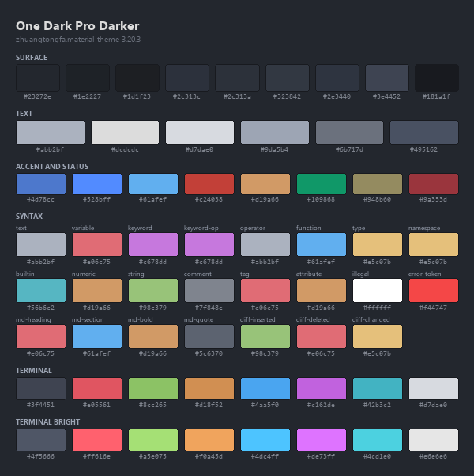

# One Dark Pro Darker配色提取

VSCode当前用的是One Dark Pro的Darker变体。下面的色值直接从主题文件读出，可以拿到别处用。

## 一、来源与生效范围

| 项 | 值 |
|---|---|
| 扩展 | zhuangtongfa.material-theme |
| 版本 | 3.20.3 |
| 主题名 | One Dark Pro Darker |
| 主题文件 | 扩展目录内的`themes/OneDark-Pro-darker.json` |
| 用户覆盖 | 无。`workbench.colorCustomizations`为空，也没有设置任何`oneDarkPro.*`选项 |

223个配色键用到83个色值，272条token规则用到13个，去重后共89个，其中27个带alpha。

扩展在改动`oneDarkPro.*`设置时会重新生成并覆盖该文件（逻辑在`out/utils/updateTheme.js`）。设置里没有这些键，文件也没被改过，所以磁盘上的就是运行时值。

## 二、与基础版One Dark Pro的差异

Darker只动了底色这一层，31个键整体下移一档。

| 基础版 | Darker | 涉及部件 |
|---|---|---|
| `#282c34` | `#23272e` | 编辑器、活动标签、终端、标题栏、活动栏 |
| `#21252b` | `#1e2227` | 侧边栏、状态栏、非活动标签、各种悬浮部件 |

前景色、语法色、终端ANSI十六色在两版之间完全相同。已有基础版配色时，换到Darker只需替换这两档底色。

## 三、色板总览



图按表面、文字、强调与状态、语法、终端五组排列，每个色块下方标注十六进制值。

## 四、表面与线条

| 变量 | 色值 | 用在 |
|---|---|---|
| `--odp-bg-editor` | `#23272e` | 编辑器、活动标签、终端、标题栏 |
| `--odp-bg-sidebar` | `#1e2227` | 侧边栏、状态栏、非活动标签 |
| `--odp-bg-input` | `#1d1f23` | 输入框、内联对话输入区 |
| `--odp-bg-raised` | `#2c313c` | 当前行、悬浮选中、内联提示底 |
| `--odp-bg-hover` | `#2c313a` | 列表悬停与活动选中 |
| `--odp-bg-inactive` | `#323842` | 列表失焦选中、标签悬停 |
| `--odp-bg-quote` | `#2e3440` | 引用块、演练页嵌入区 |
| `--odp-line-strong` | `#3e4452` | 面板分隔线、焦点边框 |
| `--odp-line-soft` | `#181a1f` | 标签页、悬浮窗、贴顶栏描边 |

区域靠底色档差区分，`#23272e`与`#1e2227`只差一档；线条只有强弱两级，不用描边切分界面。复用到别处时保持底色不超过四档、线条不超过两级，观感与原主题接近。

## 五、文字层级

| 变量 | 色值 | 用在 |
|---|---|---|
| `--odp-fg` | `#abb2bf` | 正文、变量、标点 |
| `--odp-fg-strong` | `#dcdcdc` | 活动标签标题 |
| `--odp-fg-ui` | `#d7dae0` | 活动栏图标、列表选中项 |
| `--odp-fg-muted` | `#9da5b4` | 状态栏、非活动标题栏 |
| `--odp-fg-dim` | `#6b717d` | 灰化文字、占位符 |
| `--odp-fg-faint` | `#495162` | 行号、弱提示 |

正文只有一个色值`#abb2bf`，更亮的`#dcdcdc`只给当前活动元素。后三级（`#9da5b4`、`#6b717d`、`#495162`）差距很小，放在正文里读不清，它们是给辅助信息的。

## 六、强调色与状态色

| 变量 | 色值 | 用在 |
|---|---|---|
| `--odp-accent` | `#4d78cc` | 徽标、远程状态、头像底 |
| `--odp-cursor` | `#528bff` | 光标 |
| `--odp-link` | `#61afef` | 链接、聚焦边框 |
| `--odp-error` | `#c24038` | 错误与错误图标 |
| `--odp-warning` | `#d19a66` | 警告 |
| `--odp-added` | `#109868` | 新增行标记 |
| `--odp-modified` | `#948b60` | 修改行标记 |
| `--odp-deleted` | `#9a353d` | 删除行标记 |

`#4d78cc`与`#61afef`是两个蓝。前者只做UI强调（徽标、头像、远程状态），后者是文本蓝，链接与语法里的函数名共用。两者不要互换，换了强调色会同时对应两种语义。

状态三色`#c24038`、`#948b60`、`#9a353d`饱和度偏低，在暗底上不抢眼，仍能区分。

## 七、语法配色

| 用途 | 变量 | 色值 | 对应scope |
|---|---|---|---|
| 默认文本与标点 | `--odp-text` | `#abb2bf` | `variable.parameter.function` |
| 变量名 | `--odp-variable` | `#e06c75` | `variable` |
| 关键字 | `--odp-keyword` | `#c678dd` | `keyword` |
| 关键字运算符 | `--odp-keyword-op` | `#c678dd` | `keyword.operator.word` |
| 运算符 | `--odp-operator` | `#abb2bf` | `keyword.operator` |
| 函数调用 | `--odp-function` | `#61afef` | `entity.name.function` |
| 类与类型 | `--odp-type` | `#e5c07b` | `entity.name.type` |
| 命名空间 | `--odp-namespace` | `#e5c07b` | `entity.name.namespace` |
| 内置函数 | `--odp-builtin` | `#56b6c2` | `support.function` |
| 数字与常量 | `--odp-numeric` | `#d19a66` | `constant.numeric` |
| 字符串 | `--odp-string` | `#98c379` | `string` |
| 注释 | `--odp-comment` | `#7f848e` | `comment` |
| 标签 | `--odp-tag` | `#e06c75` | `entity.name.tag` |
| 属性名 | `--odp-attribute` | `#d19a66` | `entity.other.attribute-name` |
| 非法内容 | `--odp-illegal` | `#ffffff` | `invalid.illegal` |
| 错误标记 | `--odp-error-token` | `#f44747` | `token.error-token` |
| Markdown标题 | `--odp-md-heading` | `#e06c75` | `markup.heading` |
| Markdown章节 | `--odp-md-section` | `#61afef` | `entity.name.section` |
| Markdown加粗 | `--odp-md-bold` | `#d19a66` | `markup.bold` |
| Markdown引用 | `--odp-md-quote` | `#5c6370` | `markup.quote.markdown` |
| 差异插入行 | `--odp-diff-inserted` | `#98c379` | `markup.inserted` |
| 差异删除行 | `--odp-diff-deleted` | `#e06c75` | `markup.deleted` |
| 差异变更行 | `--odp-diff-changed` | `#e5c07b` | `markup.changed.diff` |

语义色只有八个：红`#e06c75`、黄`#e5c07b`、紫`#c678dd`、蓝`#61afef`、青`#56b6c2`、绿`#98c379`、橙`#d19a66`、白`#ffffff`，加两个灰。

一个色值承担多个角色是有意的：红既是变量名，也是HTML标签与删除行；橙既是数字，也是属性名与JSON键。这些角色在同一屏里位置分开，不会混。`#f44747`（错误标记）与`#5c6370`（Markdown引用）只在个别scope出现。

注释灰`#7f848e`比正文灰`#abb2bf`暗三档，扫读时可以直接跳过注释。

## 八、终端ANSI

| 名称 | 常规 | 亮色 |
|---|---|---|
| Black | `#3f4451` | `#4f5666` |
| Red | `#e05561` | `#ff616e` |
| Green | `#8cc265` | `#a5e075` |
| Yellow | `#d18f52` | `#f0a45d` |
| Blue | `#4aa5f0` | `#4dc4ff` |
| Magenta | `#c162de` | `#de73ff` |
| Cyan | `#42b3c2` | `#4cd1e0` |
| White | `#d7dae0` | `#e6e6e6` |

终端色比语法色饱和，它不出现在代码正文里。搬到代码高亮上会偏艳。CSS里对应的变量名是`--odp-ansi-black`到`--odp-ansi-white`，亮色加`bright-`前缀。

## 九、半透明层的实底换算

27个键用了八位十六进制，后两位是alpha。搬到不支持alpha的场合（部分终端主题、图表库、打印）会被忽略或解析错，所以下面给出在对应底色上合成后的不透明值。下表列编辑器覆盖层与滚动条这12个常用项，其余同类项见[onedark-pro.json](onedark-pro.json)的`flattened`。

| 键 | 原始 | 合成后 | 合成基数 |
|---|---|---|---|
| `editor.selectionBackground` | `#67769660` | `#3d4555` | `#23272e` |
| `editor.selectionHighlightBackground` | `#ffd33d44` | `#5e5532` | `#23272e` |
| `editor.wordHighlightBackground` | `#d2e0ff2f` | `#434955` | `#23272e` |
| `editor.findMatchBackground` | `#d19a6644` | `#51463d` | `#23272e` |
| `editor.findMatchHighlightBackground` | `#ffffff22` | `#40444a` | `#23272e` |
| `editorIndentGuide.activeBackground1` | `#c8c8c859` | `#5d5f64` | `#23272e` |
| `editorWhitespace.foreground` | `#ffffff1d` | `#3c4046` | `#23272e` |
| `editorRuler.foreground` | `#abb2bf26` | `#373c44` | `#23272e` |
| `terminal.selectionBackground` | `#abb2bf30` | `#3d4149` | `#23272e` |
| `scrollbarSlider.background` | `#4e566660` | `#30363f` | `#1e2227` |
| `scrollbarSlider.hoverBackground` | `#5a637580` | `#3c434e` | `#1e2227` |
| `scrollbarSlider.activeBackground` | `#747d9180` | `#49505c` | `#1e2227` |

合成值只在对应该底色时准确。换了底色要按同样的alpha重算，脚本里`composite()`做的就是这一步。CSS里这些合成值的变量名是`--odp-flat-`加键名（点换成中线），例如`--odp-flat-editor-selectionbackground`。

## 十、文件构成

| 文件 | 内容 |
|---|---|
| [README.md](README.md) | 本文 |
| [onedark-pro.css](onedark-pro.css) | 74个CSS变量，分表面、文字、强调、状态、语法、终端、合成值七组 |
| [onedark-pro.json](onedark-pro.json) | 结构化色板，含`workbenchColors`全部223个原始键 |
| [palette.png](palette.png) | 色板图，1800x1806，按容器宽等比显示 |
| [extract.py](build/extract.py) | 提取脚本，读主题文件后重新生成上面三个产物 |
| [deepseek-chat/](deepseek-chat/README.md) | 把同一套色板套到chat.deepseek.com的油猴脚本 |
| [dsh/](dsh/README.md) | 把同一套色板套到DSH聊天界面的客户端插件 |
| [codex/](codex/README.md) | Codex桌面版的外观参数与合并脚本 |
| [typora/](typora/README.md) | Typora主题，正文与代码统一Cascadia Mono |

在CSS里引入即可：

```css
@import url("onedark-pro.css");

body {
  background: var(--odp-bg-editor);
  color: var(--odp-fg);
}
```

要拿单个色值或做程序化处理用JSON。[onedark-pro.json](onedark-pro.json)里`syntaxScopes`记录了每个语法变量对应的scope，改主题后可以对照检查有没有漏。

## 十一、复现与校验

主题升级或改了`oneDarkPro.*`设置后，重跑脚本即可更新全部产物：

```powershell
python onedark-pro\build\extract.py
```

脚本按通配符找最新的扩展版本目录，不需要改路径。

核对磁盘值是否等于运行时值：在VSCode里执行`Developer: Generate Color Theme From Current Settings`，生成的JSON是运行时结果。与这里的`workbenchColors`对比，对不上说明设置里加了覆盖。
