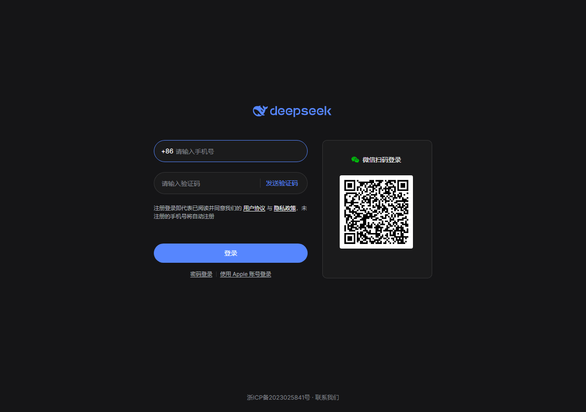
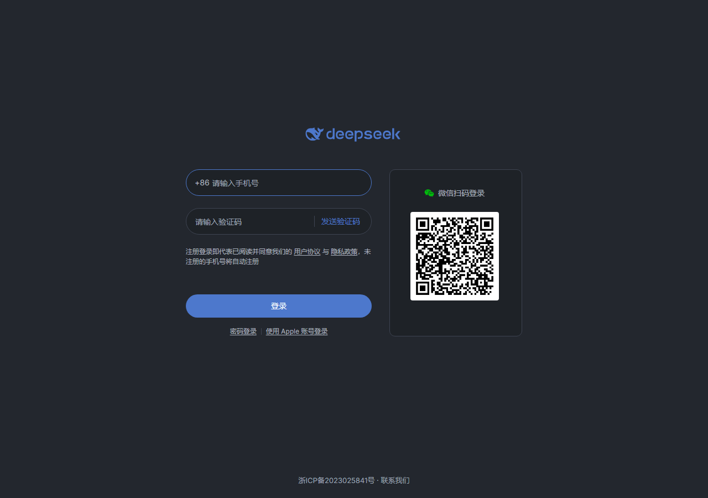
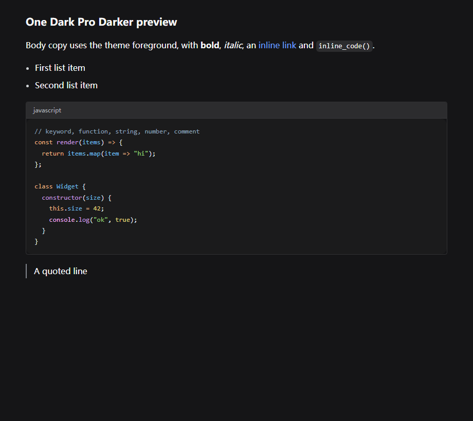
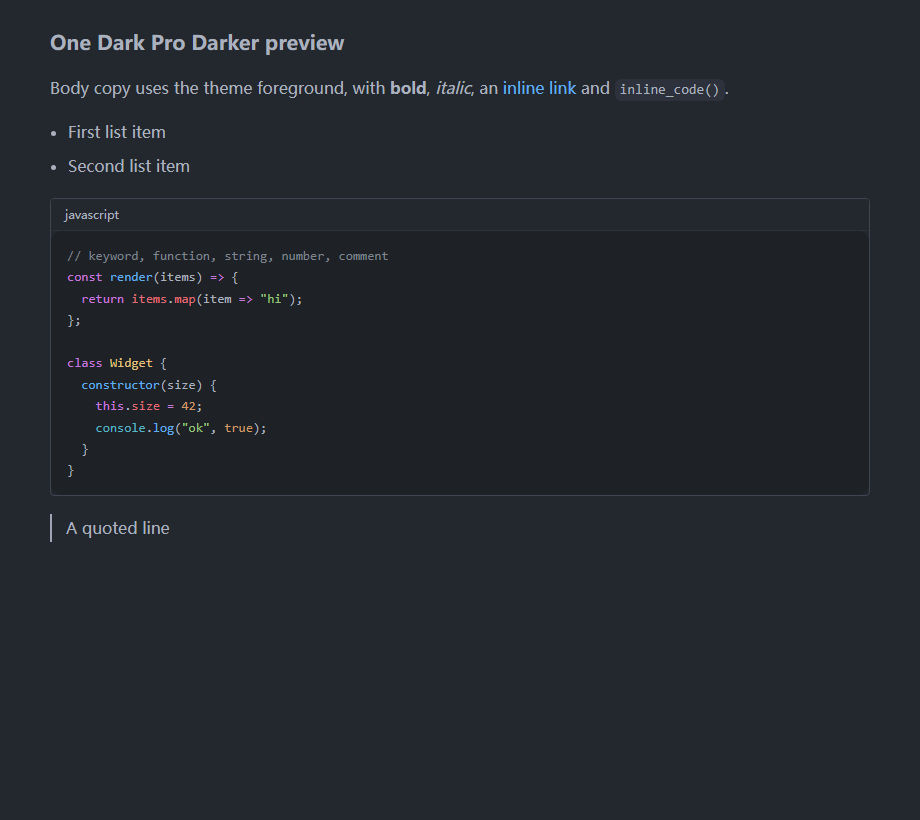
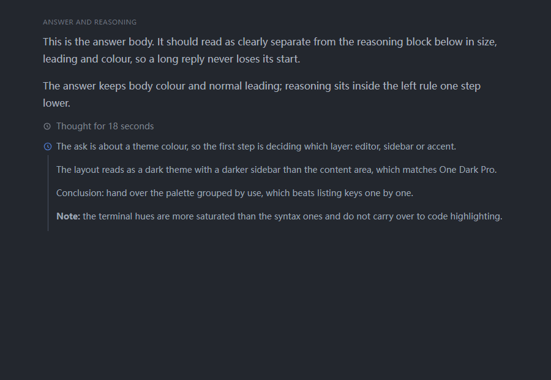
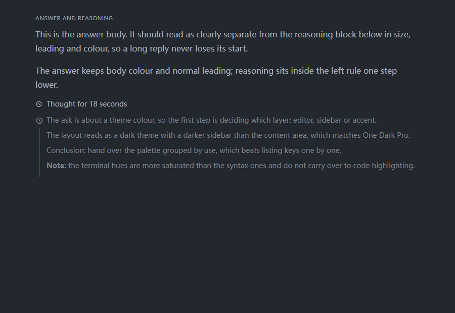

# DeepSeek Chat皮肤

把One Dark Pro Darker的色值套到chat.deepseek.com上。产物是一份油猴脚本，另外附一份等效的CSS。

## 一、安装

油猴脚本：

1. 装Tampermonkey或Violentmonkey。
2. 新建脚本，粘贴[onedark-deepseek.user.js](onedark-deepseek.user.js)全文，保存。
3. 打开chat.deepseek.com，右下角设置里确认是深色模式。

脚本头部带`@updateURL`与`@downloadURL`，指向仓库里的raw地址，Tampermonkey按`@version`检查更新。也可以直接从raw地址装：

```text
https://github.com/invefa/OneDark-Pro/raw/refs/heads/main/deepseek-chat/onedark-deepseek.user.js
```

Stylus用户直接导入[onedark-deepseek.css](onedark-deepseek.css)，URL前缀填`https://chat.deepseek.com/`，不需要额外写选择器。

亮色模式下皮肤不生效：脚本先等`data-ds-dark-theme`出现再注入，由`CONFIG.requireDarkAttribute`控制。设成`false`会对亮色也生效，但亮色的token映射没验证过。

不装扩展也可以先看效果：把CSS内容包成`<style>`挂到`document.head`，刷新即恢复。

## 二、做法

站点在`body[data-ds-dark-theme]`上定义了三级设计token：

| 层级 | 前缀 | 作用 |
|---|---|---|
| 原始色板 | `--dsw-static-*` | 中性阶、品牌蓝、状态色 |
| 语义层 | `--dsw-alias-*` | 背景层级、文字层级、边框、状态、Markdown |
| 组件层 | `--dsw-specific-*` | 侧栏、气泡、菜单、选择器 |

改这些变量的值比逐个覆盖元素样式稳：会话里后渲染的气泡、右键菜单、代码块都会跟着变，站点调整DOM时也不容易失效。代价是要跟着站点的token名走。

代码块是例外：它用Prism的`.token.*`类，站点自带一套偏one-dark的配色（注释`#8da1b9`、标签`#6cc`、函数`#c699e3`），这里换成One Dark Pro自己的分配。

## 三、映射关系

| DeepSeek token | 主题值 | 取自 |
|---|---|---|
| `--dsw-alias-bg-base` | `#23272e` | 编辑器底 |
| `--dsw-specific-sidebar-fill` | `#1e2227` | 侧栏底 |
| `--dsw-specific-input-major` | `#1d1f23` | 输入底 |
| `--dsw-specific-bubble` | `#2c313a` | 悬浮、选中 |
| `--dsw-alias-bg-layer-1` | `#2c313c` | 当前行 |
| `--dsw-alias-bg-layer-2` | `#323842` | 失焦选中 |
| `--dsw-alias-border-l2` | `#3e4452` | 强线条 |
| `--dsw-alias-label-primary` | `#abb2bf` | 正文 |
| `--dsw-alias-label-secondary` | `#abb2bf` | 与正文同色 |
| `--dsw-alias-label-tertiary` | `#abb2bf` | 会话标题、列表项 |
| `--dsw-alias-label-caption` | `#9da5b4` | 灰化、占位符 |
| `--dsw-alias-brand-primary` | `#4d78cc` | 强调 |
| `--dsw-alias-brand-text` | `#61afef` | 链接 |
| `--dsw-static-red-400` | `#e06c75` | 变量红兼错误 |
| `--dsw-static-green-500` | `#98c379` | 字符串绿兼成功 |
| `--dsw-static-amber-500` | `#d19a66` | 数字橙兼警告 |
| `--dsw-alias-markdown-code-block` | `#1e2227` | 代码块底 |

文字层级按VSCode的实际用法合并。One Dark Pro的界面文字几乎全用`#abb2bf`，只有状态栏这类降到`#9da5b4`；站点有四级文字，所以primary、secondary、tertiary都落到`#abb2bf`，caption用`#9da5b4`，dimmed留给最弱的提示。早先按"越次要越灰"逐级压暗，会话标题落到`#7f848e`，而VSCode里同一位置的资源管理器文件名是`#abb2bf`，对比之下整片发灰。

中性阶`--dsw-static-neutral-bluish-*`从00到1000共19档，主题里只有9个中性值，多档合并到同一个值。合并后仍保持由亮到暗的方向，直接读这组变量的地方不会拿到相反的颜色。

## 四、验证

用无头Edge加CDP把皮肤注入真实页面，读计算样式核对。

| 探针 | 站点原值 | 应用后 |
|---|---|---|
| `body`背景 | `#151517` | `#23272e` |
| `--dsw-alias-label-primary` | `#f9fafb` | `#abb2bf` |
| `--dsw-specific-sidebar-fill` | `#1b1b1c` | `#1e2227` |
| `.ds-input`背景 | `#1b1b1c` | `#1e2227` |
| 主按钮`.ds-button__background` | `#5686fe` | `#4d78cc` |
| 验证码分隔线 | `rgba(255,255,255,.12)` | `#3e4452` |

登录页前后对比：





代码块语法色在真实样式表下逐个读取：

| token | 站点原值 | 应用后 |
|---|---|---|
| keyword | `#e9ae7e` | `#c678dd` |
| string | `#91d076` | `#98c379` |
| comment | `#8da1b9` | `#7f848e` |
| number | `#e6d37a` | `#d19a66` |
| function | `#c699e3` | `#61afef` |
| class-name | `#6cb8e6` | `#e5c07b` |
| variable | `#6cb8e6` | `#e06c75` |
| property | `#6cb8e6` | `#e06c75` |
| builtin | `#f4adf4` | `#56b6c2` |
| operator | `#e9ae7e` | `#c678dd` |
| punctuation | `#e3eaf2` | `#abb2bf` |

代码块效果，前一张是站点原样：





没有登录账号，聊天主界面没法在无头浏览器里走通。登录页与代码块都实测过。会话区用的是同一套`--dsw-alias-*`与`--dsw-specific-bubble`token，风险集中在硬编码色上，见第六节。

## 五、深度思考块

站点的深度思考块自带图标、左侧竖线和22px缩进，结构上是分开的。问题在文字层级：答复取`label-primary`，思考取`label-secondary`，站点原值`#f9fafb`与`#cfd3d6`相差明显，但这套映射把两档都落到`#abb2bf`，展开后思考与答复完全同色，只剩字号和缩进的区别。

| 位置 | 站点原值 | 皮肤初版 | 现在 |
|---|---|---|---|
| 答复正文 | `#f9fafb` | `#abb2bf` | `#abb2bf` |
| 思考正文 | `#cfd3d6` | `#9da5b4` | `#7f848e` |
| 思考行高 | 24px | 24px | 22px |
| 思考里的加粗 | `#abb2bf` | `#abb2bf` | `#7f848e` |

思考正文压到注释灰`#7f848e`，行高22px，段落间距8px。块内除代码与链接外的所有元素都封在这个灰上，加粗与标题只靠字重和字号区分，不会再比正文亮。答复侧不变。





两张图只差这一组规则：前一张思考与答复同色，后一张过程与结论分开。

## 六、已知边界

- 硬编码色不跟随，例如主按钮聚焦阴影写死成`#4d6bfe`。这类值在站点样式表里只有个位数处。
- 站点改版可能改token名。皮肤按当前名写死，更新后若局部回退原色，先抓`main.*.css`核对`--dsw-*`。
- 只做配色，字号、字体、圆角、间距不动，避免与站点的响应式布局冲突。

## 七、文件

| 文件 | 内容 |
|---|---|
| [onedark-deepseek.user.js](onedark-deepseek.user.js) | 油猴脚本，内置全部CSS |
| [onedark-deepseek.css](onedark-deepseek.css) | 等效样式表，给Stylus或手动注入用 |
| [gen.py](build/gen.py) | 生成脚本，读`../onedark-pro.json`重写上面两份 |
| [demo.html](build/demo.html) | 本地预览页，加载站点真实样式表加皮肤 |
| [shot.mjs](build/shot.mjs) | 无头Edge截图 |
| [probe.mjs](build/probe.mjs) | 读计算样式，定位没被覆盖的元素 |
| [tokens.mjs](build/tokens.mjs) | 校验Prism各token的实际色值 |
| [verify-userscript.mjs](build/verify-userscript.mjs) | 验证脚本在暗色与亮色两条路径下的行为 |
| [think-demo.html](build/think-demo.html) | 思考块复现页，用站点真实类名搭的 |
| [think-shot.mjs](build/think-shot.mjs) | 思考块前后对比截图与计算样式 |
| [ds-main.css](build/ds-main.css) | 站点样式表快照，token名、思考块与Prism类名从这份取 |
| [images/](images/) | 前后对比截图 |

调色后重新生成：

```powershell
python build\gen.py
```

脚本只依赖`../onedark-pro.json`，改主题色时改那一份即可。

`build/ds-main.css`是站点样式表的快照，属第三方产物，没有入库。跑复现页与截图前先取一份，文件名里的哈希随站点更新变化，从页面源码的`<link rel="stylesheet">`里取当前值：

```powershell
Invoke-WebRequest -Uri "https://fe-static.deepseek.com/chat/static/main.1e9681a4d3.css" -OutFile build\ds-main.css
```

截图与探针脚本用CDP驱动本机的Chromium内核浏览器，浏览器路径不写死：先在`PATH`里找`msedge`、`chrome`、`chromium`，找不到就读`EDGE_PATH`环境变量。

```powershell
$env:EDGE_PATH = "<浏览器可执行文件路径>"
node build\shot.mjs
```
