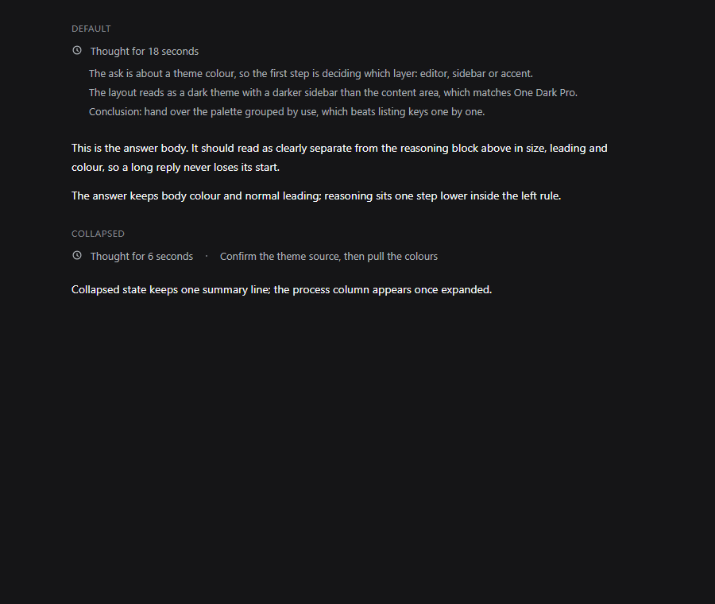
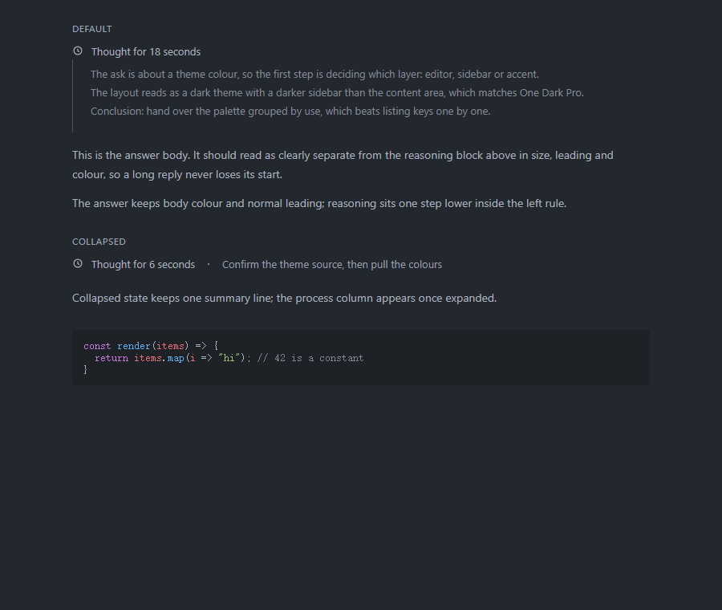

# DSH配色

DSH的Web界面与chat.deepseek.com用同一套`--dsw-*`设计token，定义在`body[data-ds-dark-theme]`上。这里把One Dark Pro Darker的色值映射进去，做成一个客户端插件。

| 项 | 值 |
|---|---|
| 目标 | DSH Web界面，桌面版同源 |
| 覆盖 | 148个`--dsw-*`token，其中26个DSH独有 |
| 形式 | 客户端插件，注入一段样式表 |





## 一、改法

token分三层，皮肤改的是这三层的值：

| 层级 | 前缀 | 作用 |
|---|---|---|
| 原始色板 | `--dsw-static-*` | 中性阶、品牌蓝、状态色 |
| 语义层 | `--dsw-alias-*` | 背景层级、文字层级、边框、状态、Markdown |
| 组件层 | `--dsw-specific-*`、`--dsw-menu-*` | 侧栏、气泡、菜单、选择器 |

映射与[DeepSeek网页皮肤](../deepseek-chat/README.md)共用同一份。`dsh/build/gen.py`把`deepseek-chat/build/gen.py`当模块加载，直接调用它的`token_block()`，再补DSH独有的26个token（文档预览、deep diving状态、菜单、diff、switch这类）。色表只有一份，两边不会各自漂移。

代码块走Shiki的`css-variables`主题，每个token的颜色是`var(--shiki-token-*)`，定义这组变量就能整体换色。这套主题只有十个类别：`entity.name.type`、`entity.name.function`与`meta.function-call`共用`--shiki-token-function`，数字与普通变量共用`--shiki-token-constant`。所以类型名与函数名同色、数字与变量同色。常量槽用数字橙`#d19a66`，标识符与数字同色；VSCode里标识符是黄`#e5c07b`、数字是橙，这里只能取一个。

代码字体单独设了一层。DSH的代码块读`--ds-font-family-code`，这个变量由主题插件按设置注入，默认是系统等宽。皮肤把它固定成`Cascadia Code, Consolas, Microsoft YaHei Mono, monospace`，与VSCode、Codex保持一致。想改字体就改`build/gen.py`里的`CODE_FONT`。

推理块单独处理。DSH用正文色渲染推理行，展开后与答复同色，只能靠字号和22px缩进区分，所以给它加一条左侧细线、压一档灰、收紧行距。推理正文不总包在`<p>`里，选择器用`._3GBCTG_thinkBody :not(pre):not(code):not(a):not(.md-code-block)`，除代码与链接外全部压暗，不依赖段落标签。

## 二、实测

用DSH前端的真实样式表搭复现页，注入皮肤后读计算样式：

| 探针 | DSH默认 | 应用后 |
|---|---|---|
| 页面底色 | `#151517` | `#23272e` |
| 答复正文 | `rgb(249,250,251)` | `rgb(171,178,191)` |
| 推理正文 | `rgb(173,178,184)` | `rgb(123,129,140)` |
| 推理行高 | 24px | 19px |
| 推理栏左边线 | 无 | 1px `rgb(73,81,98)` |
| 代码keyword | 跟随正文 `rgb(249,250,251)` | `rgb(198,120,221)` |
| 代码string | 同上 | `rgb(152,195,121)` |
| 代码comment | 同上 | `rgb(127,132,142)` |
| 代码function | 同上 | `rgb(97,175,239)` |
| 代码parameter | 同上 | `rgb(224,108,117)` |

## 三、安装

界面产物在`app.asar`里，没有用户可写的样式表，不进打包产物的入口只有插件。插件在[plugin/](plugin/)下，包清单用`dsh.bundle.patch`指向`cordis.patch.yml`，由它`insert`一条插件记录；客户端入口用`window.__ModuleLoader__.load`注册，`apply()`注入一个`<style>`。

1. 侧边栏打开Plugins页，安装本地目录`plugin/`；或在该profile目录（`~/.dsh/profiles/web`）下执行`pnpm add file:<仓库路径>/dsh/plugin`。

2. 确认`dsh-onedark`这条bundle处于启用状态。

3. 重启DSH。

卸载：Plugins页禁用即可，样式随插件一起消失。

这个插件没有在运行中的DSH里验证过，验证受限是因为开发会话本身跑在DSH上，重启会中断它。已经验证的是插件的注册与注入逻辑（`build/verify-client.mjs`用桩DOM跑通，重复apply不会叠第二份）和样式在DSH真实CSS下的效果。装之前记一下Plugins页的bundle列表，万一加载失败，禁用该项就能回到原样。

不想重启时可以先看效果：在窗口里打开开发者工具，控制台把[onedark.css](onedark.css)的内容塞进一个`<style>`再挂到`document.head`，刷新即失效。

```js
const s = document.createElement("style");
s.textContent = `<把 onedark.css 的内容贴进来>`;
document.head.appendChild(s);
```

开发者工具是否可用取决于打包时有没有开启，打不开就只能走插件。

## 四、边界

- 类名是构建哈希。`_3GBCTG_`对应`@deepseek-ai/dsh-client-ui-chat`当前版本的ReasoningRow，DSH升级后前缀可能变，推理块的规则会静默失效，token配色不受影响。排查办法：`build/extract-css.py`重新抽一次，看前缀。
- 代码块依赖`css-variables`主题。DSH若换成别的Shiki主题，`--shiki-token-*`不再被引用，代码块会回到高亮器自带的配色。
- 只做配色，字号、字体、圆角、间距不动。
- diff的增删底色用rgba叠在页面底色上，不跟随主题变浅变深；换浅色主题时需要重算。

## 五、文件

| 文件 | 内容 |
|---|---|
| [onedark.css](onedark.css) | 生成的皮肤，注入用的就是它 |
| [plugin/](plugin/) | 客户端插件包，`lib/client.js`由样式生成 |
| [gen.py](build/gen.py) | 生成脚本，复用DeepSeek皮肤的token映射 |
| [gen.mjs](build/gen.mjs) | 读CSS重新生成插件里的客户端包 |
| [demo.html](build/demo.html) | 复现页，加载真实CSS与真实类名 |
| [shot.mjs](build/shot.mjs) | 无头Edge截图与计算样式对比 |
| [edge.mjs](../build/edge.mjs) | 浏览器路径解析，与deepseek-chat共用 |
| [verify-client.mjs](build/verify-client.mjs) | 桩DOM验证插件注册与注入 |
| [extract-asar.cjs](build/extract-asar.cjs) | 从app.asar取文件 |
| [extract-css.py](build/extract-css.py) | 从插件bundle抽出运行时注入的样式表 |
| [extract-tokens.py](build/extract-tokens.py) | 抽出主题token的CSS |

改色后重新生成并验证：

```powershell
python build\gen.py
node build\gen.mjs
node build\verify-client.mjs
```

`build/index.css`、`build/tokens.css`与`build/css/`是DSH前端样式表的快照，属第三方产物，没有入库。跑复现页与截图前先抽一份：

```powershell
node build\extract-asar.cjs "<DSH安装目录>\resources\app.asar" "/dsh/node_modules/@deepseek-ai/dsh-web-frontend/dist/assets/index-BxpfOGf3.css" build\index.css
node build\extract-asar.cjs "<DSH安装目录>\resources\app.asar" "/dsh/node_modules/@deepseek-ai/dsh-client-ui-theme/lib/client.js" build\theme-client.js
python build\extract-tokens.py build\theme-client.js build\tokens.css
node build\extract-asar.cjs "<DSH安装目录>\resources\app.asar" "/dsh/node_modules/@deepseek-ai/dsh-client-ui-chat/lib/client.js" build\chat-client.js
python build\extract-css.py build\chat-client.js build\css
```

DSH升级后如果类名前缀变了，用最后两步重新抽样式，对照新的`ReasoningRow.module.css`改选择器。
