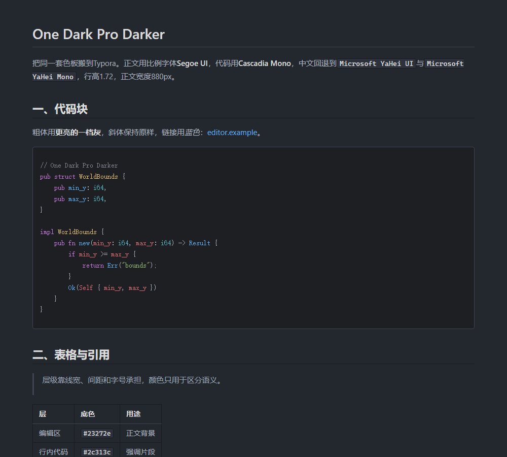
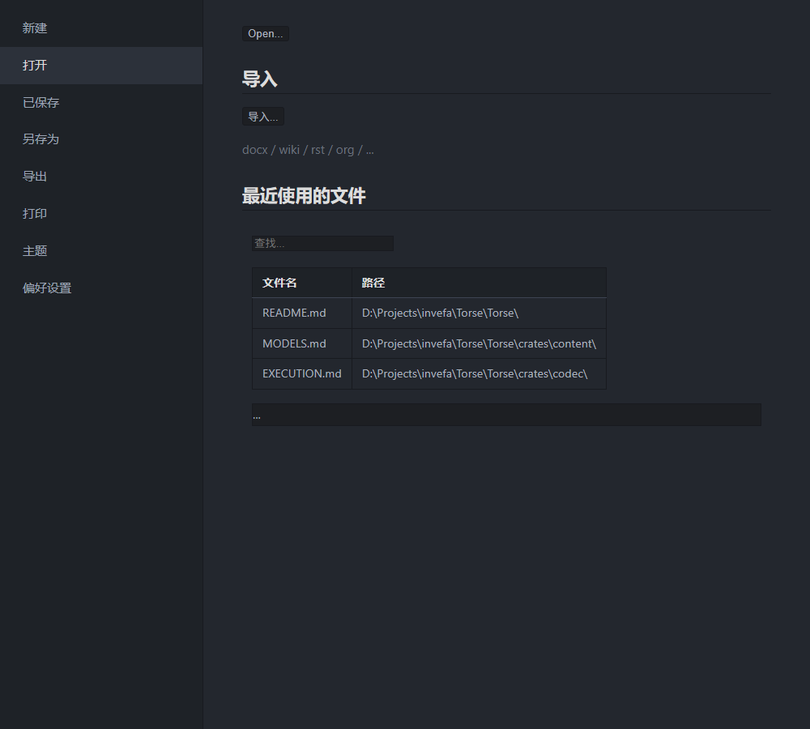

# Typora主题

一份One Dark Pro Darker的Typora主题。正文用比例字体，代码用Cascadia Mono，中英混排各自回退到等宽或黑体。样式由[build/gen.py](build/gen.py)从根目录的[onedark-pro.json](../onedark-pro.json)生成，色值只有一个来源。





## 一、安装

把[onedark-pro-darker.css](onedark-pro-darker.css)放进Typora的用户主题目录：

```text
%APPDATA%\Typora\themes\
```

然后在Typora里打开`偏好设置 - 外观 - 主题`，选择`onedark-pro-darker`。修改后重新选中一次即可刷新，不必重启。

卸载就是删掉那个文件，偏好设置里换回其它主题。

## 二、配色

| 位置 | 取值 | 说明 |
|---|---|---|
| 编辑区底 | `#23272e` | Darker的编辑器背景 |
| 侧栏与菜单底 | `#1e2227` | 比正文区暗一档 |
| 正文 | `#abb2bf` | |
| 标题与加粗 | `#dcdcdc` | 比正文亮一档 |
| 引用与次要文字 | `#9da5b4` | |
| 链接 | `#61afef` | |
| 行内代码底 | `#2c313c` | 抬高一层的灰 |
| 围栏代码底 | `#1d1f23` | 比正文区暗，形成内凹 |
| 分隔线与表格线 | `#3e4452` / `#181a1f` | |

代码高亮用VS Code主题里的语法色：关键字紫`#c678dd`、字符串绿`#98c379`、数字与属性橙`#d19a66`、函数蓝`#61afef`、类型黄`#e5c07b`、变量红`#e06c75`、内建cyan`#56b6c2`、注释灰`#7f848e`。

层级主要靠字号、行高和线宽，颜色只用于区分语义：标题只加亮不加色，链接与光标共用一个强调色。

## 三、字体

```css
--font-prose: "Segoe UI", "Microsoft YaHei UI", "Microsoft YaHei", system-ui, sans-serif;
--monospace: "Cascadia Mono", "Microsoft YaHei Mono", Consolas, monospace;
```

正文用比例字体，长段中文读起来不累。代码与行内代码用Cascadia Mono，中文回退到`Microsoft YaHei Mono`，与西文同属等宽，混排时不跳字体。

用Cascadia Mono而不是Cascadia Code，后者带编程连字，`=>`、`!=`会连成图形式样，容易和符号混淆。

想让正文也用等宽，把`--font-prose`改成与`--monospace`相同的栈即可，代码部分不受影响。

## 四、外壳

Typora的菜单面板、偏好设置、右键菜单、弹窗不吃`--bg-color`，它们各自带浅色底与背景图案。主题里对这些面单独覆盖：

| 选择器 | 覆盖内容 |
|---|---|
| `.megamenu-content` | 菜单右侧面板，强制去掉浅色底与背景图案 |
| `.megamenu-menu`、`.megamenu-menu-list` | 左侧菜单及其悬停、选中态 |
| `#recent-file-panel`、`#recent-document-table` | 最近文件表格与查找框 |
| `.long-btn`、`#recent-file-panel-action-btn` | 面板上的按钮 |
| `.modal-content`、`.dropdown-menu` | 插入表格弹窗与右键菜单 |
| `.ty-preferences` | 偏好设置窗口 |

## 五、边界

- 只改配色与字体，不动Typora的布局与交互。
- 导出与打印走独立的亮色样式，避免深底打印耗墨。
- Typora内部还有少数控件由平台渲染，未逐一覆盖；遇到仍然发白的界面，把元素截图给我补规则。

## 六、文件

| 文件 | 内容 |
|---|---|
| [onedark-pro-darker.css](onedark-pro-darker.css) | 生成的主题，直接复制到Typora |
| [build/gen.py](build/gen.py) | 读取色板并生成主题 |
| [build/demo.html](build/demo.html) | 正文与代码的预览页 |
| [build/demo-menu.html](build/demo-menu.html) | 菜单面板的预览页 |
| [images/01-preview.png](images/01-preview.png) | 正文预览截图 |
| [images/02-menu.png](images/02-menu.png) | 菜单预览截图 |
